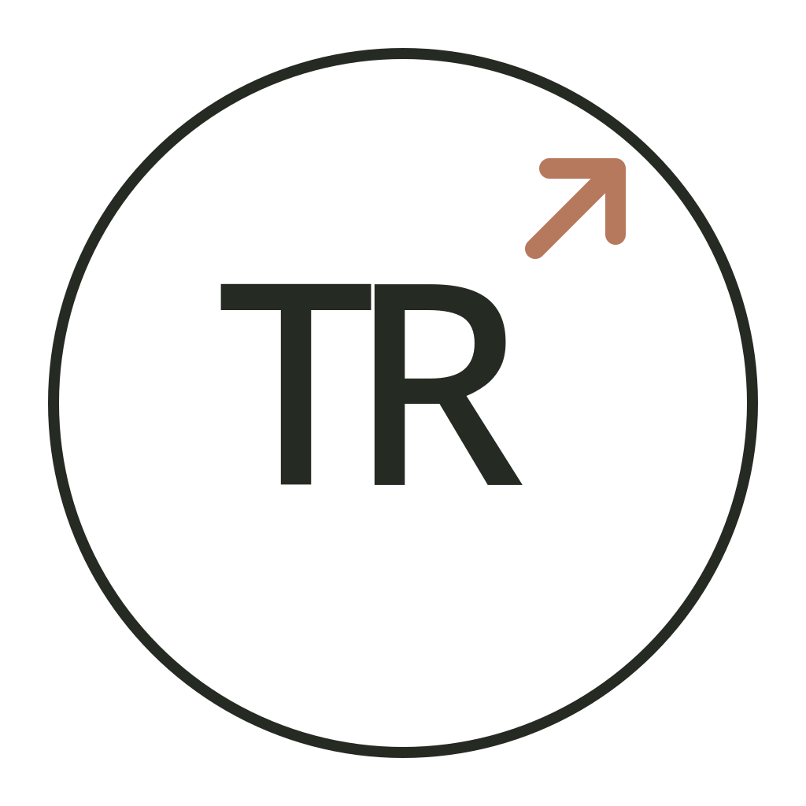

<div align="center">
  
  <h1>Easy Use Cheat Dynasty Warriors 6 Pc</h1>
  <p>A lightweight Windows trainer for Dynasty Warriors 6.</p>

  
  
</div>

---

## Features

- Infinite HP
- Infinite Musou
- Full Renbu gauge
- Instant max level / EXP
- Max highlighted weapon
- Max highlighted horse

## Getting started

### Use the launcher

1. Start **Dynasty Warriors 6** and wait until the game is running.
2. [Download `DW6_Launcher.exe`](https://github.com/aldoroku76-netizen/DW6_Cheat_Project/raw/refs/heads/main/DW6_Launcher.exe).
3. Run the launcher (Right-click the launcher and select **Run as administrator** or Properties > Compatibility > checklist Run this program as an Administrator.
4. Turn cheats on or off from the trainer window.

The trainer looks for the game process `DW6_WIN.exe`. 
- Renbu may need to be unlocked/upgrade  in-game, land a hit on an enemy for the fill gauge cheat to take effect.
- Max highlighted horse and weapon, end game your battle with get the item horse and weapon first to trigger the cheat. (to look go to Camp on main menu game)
- Instant max level / EXP, play any battle and finish the game.
- If all this button no function go relog the game
### Run from source if launcher error

Requires Windows and Python. Open Command Prompt or PowerShell as administrator, then run:

```powershell
cd D:\path\to\DW6_Cheat_Project
py -m pip install pymem
py launcher.py
```

## Notes

- For **offline, single-player use**. Do not use cheats in online or competitive play.
- Back up your save files before using memory-editing tools.
- The trainer modifies the game's process memory. Use it at your own risk; security software may flag the launcher.
- This is a fan-made, unofficial project and is not affiliated with or endorsed by Koei Tecmo.
